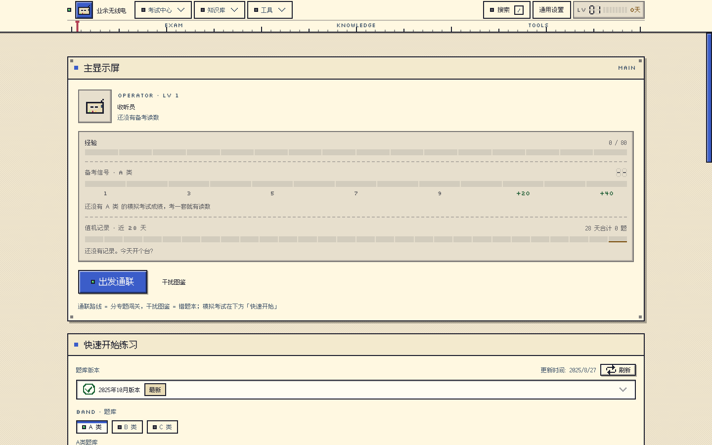
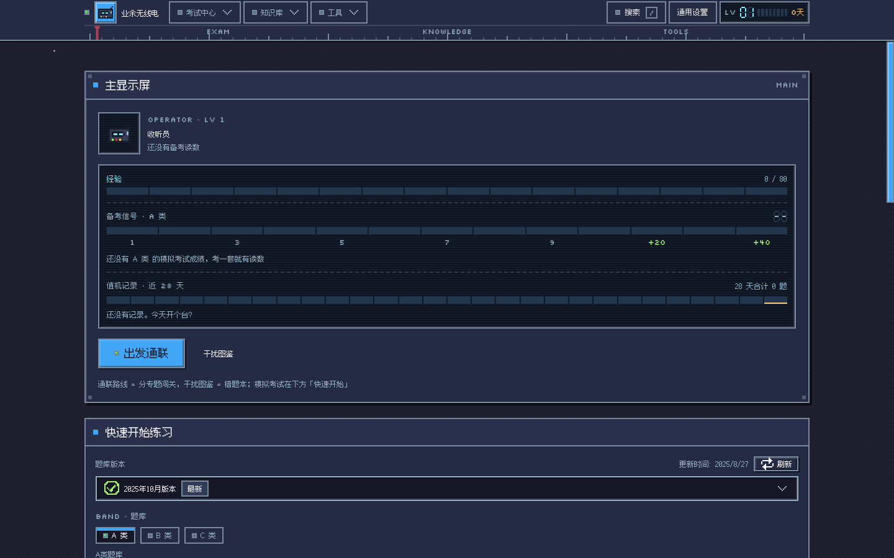
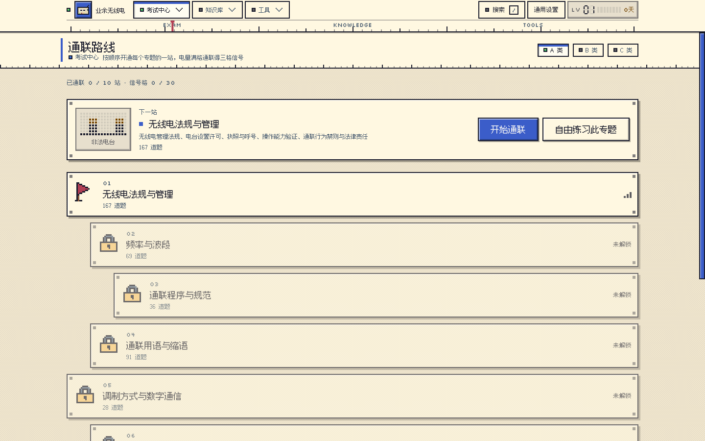
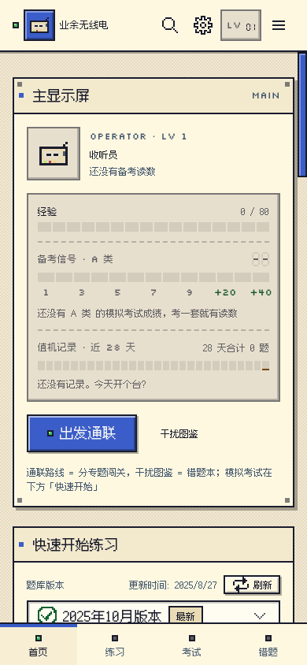
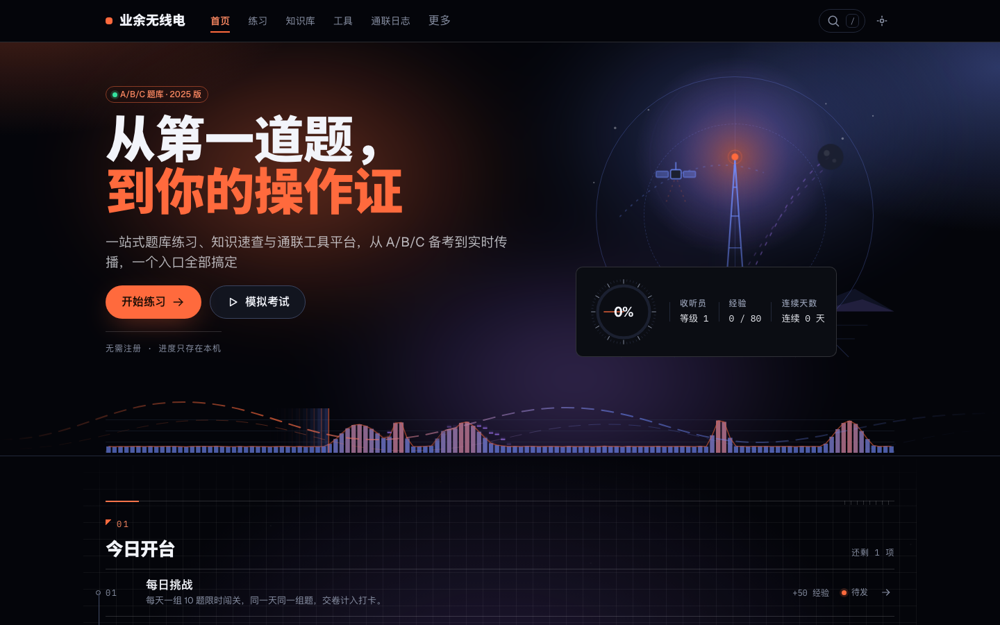
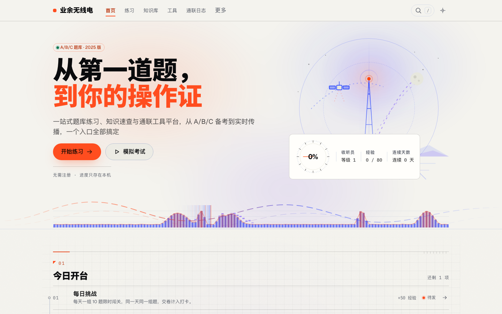
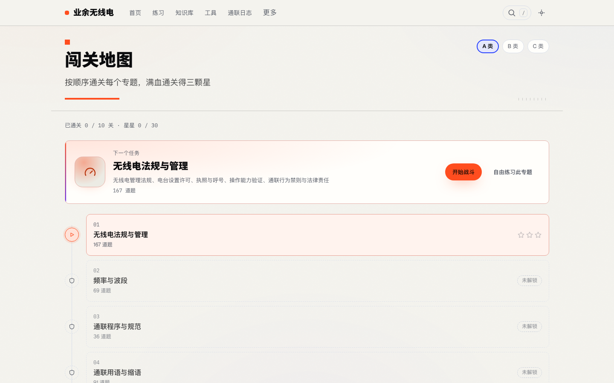
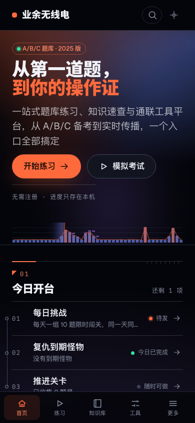
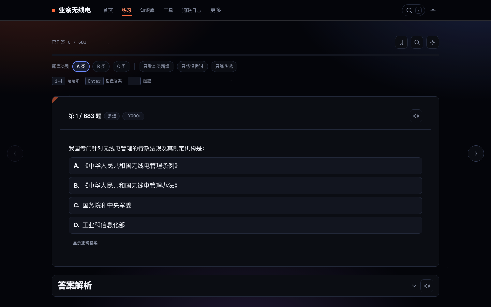

# Amateur Radio | Question Banks, Knowledge, and Tools

[简体中文](README.md) | English

[](https://github.com/lf-wxp/ham-web/actions/workflows/check.yml)
[](LICENSE)
[](https://www.rust-lang.org)
[](https://leptos.dev)
[](#pwa-and-offline)

**Live demo: <https://ham.onlyxp.me/>** | [Quick start](#quick-start) | [Feature overview](#feature-overview) | [Documentation map](#documentation-map) | [Contributing](#contributing)

> This page is the English companion to the canonical [`README.md`](README.md). Generated counts and task lists are maintained there and checked by `cargo make readme-check`; [`docs/README.en.md`](docs/README.en.md) is the English guide to the Chinese documentation index.

A one-stop amateur-radio learning platform: practice and timed mock exams for the A/B/C question banks, a 100+ topic reference library, contact logging, live data, and everyday calculators.

**The entire project is written in Rust (2024 edition).** The frontend is Leptos (CSR compiled to WebAssembly), the server is Axum (static hosting plus a same-origin `/api/*` proxy), domain data and algorithms live in `ham-web-core`, and question-bank/explanation/build tooling is provided by the `ham-web-tools` CLI.

It is built for candidates preparing for Class A/B/C operating certificates, newcomers who want a structured introduction, and experienced operators who need logging, award tracking, and propagation tools. Personal data stays in the browser: nothing is uploaded to a server, and static hosting can work offline for everything except live-data pages.

**Two independent interfaces, one content set.** The default **Pixel UI** is a 16-bit radio front panel with signal meters, a knowledge spectrum, and operating-log readouts. The **Modern UI** has light/dark themes, responsive layouts, and keyboard-first practice. They are separate design systems, not color swaps: layout, controls, and motion all differ. Switch under **General Settings → Interface Style** in the top bar; the preference is stored locally.

### Pixel UI (default)

<p align="center">
  <a href="docs/images/home-desktop.webp"></a>
  <a href="docs/images/home-dark.webp"></a>
  <br>
  <a href="docs/images/map-desktop.webp"></a>
  <a href="docs/images/home-mobile.webp"></a>
  <br>
  <sub>Top: light and dark home pages (desktop). Bottom: learning route (desktop) and home page (mobile, scaled to the same height).</sub>
</p>

### Modern UI

<p align="center">
  <a href="docs/images/home-modern-dark.webp"></a>
  <a href="docs/images/home-modern-light.webp"></a>
  <br>
  <a href="docs/images/map-modern.webp"></a>
  <a href="docs/images/home-modern-mobile.webp"></a>
  <br>
  <a href="docs/images/practice-modern.webp"></a>
  <br>
  <sub>Top: dark and light home pages (desktop). Middle: learning route (desktop) and home page with bottom navigation (mobile, scaled to the same height). Bottom: keyboard-first practice page (dark).<br>
  These are screenshots of a local release build. To recapture them, see <code>e2e/scripts/screenshots.mjs</code> (<code>node scripts/screenshots.mjs [pixel|modern]</code>).</sub>
</p>

---

## Quick start

### Requirements

- Rust ≥ 1.99.1, matching `.tool-versions`, `Cargo.toml`, CI, and the Dockerfile
- The `wasm32-unknown-unknown` target, [Trunk](https://trunkrs.dev), and [cargo-make](https://github.com/sagiegurari/cargo-make)
- Node.js ≥ 22 (**only for end-to-end tests**; building and development do not need Node)

```bash
cargo install cargo-make
cargo make setup          # install the wasm target, Trunk, and wasm-bindgen CLI
```

> Trunk downloads Tailwind CSS and wasm-opt on first build. Decoder Workers need the `wasm-bindgen` CLI on `PATH`; `cargo make setup` pins its version from `Cargo.lock`.

| Goal | Command |
| --- | --- |
| Frontend only | `cargo make dev` → http://127.0.0.1:3000 |
| Live-data pages (need `/api/*`) | `cargo make dev-full` → backend 3001 and frontend 3000 proxy |
| Production build / local release | `cargo make build` / `cargo make serve` → http://127.0.0.1:8080 |

See [`docs/engineering/tasks.md`](docs/engineering/tasks.md) for the full task list and [`docs/engineering/deployment.md`](docs/engineering/deployment.md) for local development, production builds, and deployment.

### Browser support

| Capability | Requirement | Fallback |
| --- | --- | --- |
| Question banks / reference library / logs / calculators | Any modern browser | — |
| In-browser decoding (Web Worker + wasm) | WebAssembly | The page explains that it is unsupported |
| 3D radiation patterns | WebGL2 | Automatic SVG fallback |
| Radio CAT / KISS TNC / NanoVNA / rotator | Desktop Chrome or Edge with Web Serial | Controls are disabled with an unsupported-browser hint |
| Background push | HTTPS (or `localhost`) plus notification permission | Degrades to “push service not configured” |
| Offline use | Service Worker | Network access is still required |

## Feature overview

The Chinese [`docs/reference/features.md`](docs/reference/features.md) provides the complete per-feature reference, including paths, parameters, boundaries, and known limitations.

### Exam center

The Pixel UI home panel presents an S meter for exam readiness, a knowledge spectrum, and recent operating activity. Learning routes, interference drills, and an interference atlas derive levels from the local study archive. Practice modes include flashcards, listening drills, and callsign copying; timed A/B/C mock exams include review, a mistake book, adaptive revision, progress and weekly reports, study plans, exam-schedule guidance, achievements, calculation variants, and mistake attribution.

### Knowledge base

Topic reference pages cover Morse training, CW copying contests, band plans, antenna modeling, and other interactive material. A searchable regulations library links each article to the questions that cite it. Also included are learning paths, international exam comparisons, knowledge provenance, and self-hosted KaTeX formulas.

### Tools and live data

Calculators, solar activity and space weather, DX spots and DXCC rarity, satellite passes with Doppler correction, PSK Reporter / RBN reception reports, point-to-point MUF and reliability matrices, DXCC / grid maps, repeater-to-CHIRP CSV export, and backup/merge import.

### Antenna and RF design

A method-of-moments solver (`/nec`) with radiation patterns, frequency sweeps, saved designs, and directional gain by DXCC entity; Smith charts, a waveform lab, frequency/power compliance, and a measurement-error lab.

### Logging and QSL

ADIF 3.1 logging with multiple stations and operators, log health checks, full QSL lifecycle and confirmation syncing, contest entry (Cabrillo 3.0), award progress, QSL card and label printing, and SOTA / POTA activation exports.

### In-browser decoding and hardware

Decoder Workers run locally so audio never leaves the browser. Web Serial connects radio CAT, KISS TNC, NanoVNA, and rotator hardware; writing to a radio is off by default and guarded. See [`docs/reference/features.md`](docs/reference/features.md) for the decoder list.

### Equipment and DIY

A radio model library with Sherwood measurements, six-axis radar charts, scenario-weighted scoring, review articles, and DIY project cards.

### User experience

Press `/` for site-wide search (with `dxcc:`, `band:`, and `mode:` prefixes), switch between the two interfaces, choose among Pixel UI color schemes and light/dark themes, use one of three interface languages, and work offline through the PWA. All personal data stays local.

## Documentation map

[`docs/README.md`](docs/README.md) is the authoritative index. It organizes documentation by reader question and records when to read and who maintains each file. An English translation is available at [`docs/README.en.md`](docs/README.en.md); the detailed specifications themselves remain in Chinese.

Useful entry points:

- Before changing code: [`AGENTS.md`](AGENTS.md) — hard rules and validation commands
- UI specifications: [`docs/ui/modern.md`](docs/ui/modern.md) (Modern UI) and [`docs/ui/pixel.md`](docs/ui/pixel.md) (Pixel UI)
- Architecture and full directory tree: [`docs/engineering/architecture.md`](docs/engineering/architecture.md)
- Planned work and deliberate non-goals: [`ROADMAP.md`](ROADMAP.md)

> The Chinese README’s counts and generated lists are reconciled by `cargo make readme-check`. Moving, renaming, or deleting a section can also make that check fail.

## Technology stack

Rust 2024 (MSRV 1.99.1) with [Leptos 0.8](https://leptos.dev) compiled to WebAssembly, Tailwind CSS v4, and [Trunk](https://trunkrs.dev) for builds. Axum 0.8 serves static files and the `/api/*` proxy. Signal decoding is pure-Rust DSP compiled into Workers; audio is never uploaded. Task orchestration uses [cargo-make](https://github.com/sagiegurari/cargo-make), and a Rust build tool generates the PWA Service Worker.

The project is MIT-licensed, with GPL-3.0 exceptions for selected decoders and their Workers (see [License](#license)). The layered stack, browser APIs, and toolchain are documented in [`docs/engineering/architecture.md`](docs/engineering/architecture.md).

## Project structure

```text
crates/core                  Domain models and pure computation: questions, exams, ADIF, callsigns, propagation, storage, registry
crates/nec                   Method-of-moments antenna solver (std only, no dependencies)
crates/dsp · crates/wav      Shared DSP primitives and WAV parsing for decoders
crates/app                   Leptos frontend: pages, components, ui, i18n, store
crates/{apt,sstv,wspr,ft8,rtty,olivia,dominoex,mfsk,thor,navtex,lrpt,hell,wefax}   Decoder cores
crates/*-worker              Web Worker glue, including the afsk1200 soft TNC
crates/server                Axum static hosting, /api proxy, and /api/v1 open API
crates/tools                 Build and maintenance CLI: datasets, explanations, i18n, icons, guards
data/ · public/ · e2e/       Data and translations, build assets, Playwright tests
docs/                        Detailed specifications (Chinese); this file is the overview
```

See [`docs/engineering/architecture.md`](docs/engineering/architecture.md) for per-directory notes and layer boundaries; [`docs/engineering/code-quality.md`](docs/engineering/code-quality.md) documents guards such as “core must not touch browser APIs”.

## Backend APIs

`/api/*` is a same-origin proxy for the frontend: Axum forwards upstream requests, caches responses in memory, and avoids CORS issues. Endpoints, upstream sources, and cache durations are listed in [`docs/reference/api.md`](docs/reference/api.md). Third parties should use the isolated, backward-compatible `/api/v1/*` surface (OpenAPI 3.1 at `/api/v1/openapi.json`, documentation page at `/developers`). The same reference lists pages that depend on `/api/*` and their static-hosting fallbacks.

## Common tasks

| Task | Description |
| --- | --- |
| `cargo make setup` | Install the wasm target, Trunk, and the `Cargo.lock`-pinned wasm-bindgen CLI |
| `cargo make dev` / `dev-full` | Frontend on 3000 / plus backend 3001 and the `/api` proxy |
| `cargo make build` / `serve` | Production build (icons + frontend + server) / serve `dist/` on 8080 |
| `cargo make check` | Pre-commit gate: format, clippy, unit tests, i18n, explanations, guards, and data stamps; does not build the frontend |
| `cargo make ci` | `check` plus a release frontend build and size budget; use this before a formal commit |
| `cargo make e2e` | Build the release site and run Playwright |
| `cargo make dataset` | Rebuild question-bank JSON and images from CSV |
| `cargo make i18n-pack` | Generate runtime language packs after editing translations |
| `cargo make readme-check` | Reconcile Chinese README counts/lists, `docs/` links, and screenshot files |
| `cargo make clean` | Run `cargo clean` and remove `dist/` and `tmp/` |

For the complete task table, including decoder samples, Pixel UI assets, data sync, and explanation maintenance, see [`docs/engineering/tasks.md`](docs/engineering/tasks.md).

## Deployment

```bash
docker build -t ham-web .
docker run -d --name ham-web -p 3000:3000 -v ham-web-data:/app/data ham-web
# Or: docker compose up -d --build
```

`/app/data` contains the online-account SQLite database, Web Push subscriptions, and the VAPID private key. **Mount a volume** (named volume or host directory) so container rebuilds do not lose data.

Build arguments (`SITE_URL` / `REBUILD_DATASET` / toolchain versions), runtime and upstream tuning variables, measured build time and memory requirements (frontend compilation peaks at 6–8 GB), and Web Push VAPID/subscription authentication are documented in [`docs/engineering/deployment.md`](docs/engineering/deployment.md).

## Data and question banks

- Question-bank JSON and images are committed under `public/questions/`; day-to-day development does not need a rebuild. Run `cargo make dataset` when updating them. Sources, CSV columns, and outputs are described in [`docs/data/data-pipeline.md`](docs/data/data-pipeline.md).
- When the official question bank changes, follow “Adding a question-bank version” in that document and update `public/questions/config.json`.
- Explanations are keyed by **content fingerprint** in `data/explanations.json`. The missing → write → merge/enhance → commit workflow is in [`docs/data/explanations.md`](docs/data/explanations.md); writing rules are in [`docs/data/explanations-style.md`](docs/data/explanations-style.md).

## PWA and offline

`postbuild` scans `dist/` and generates `sw.js` (question banks use NetworkFirst, question images use StaleWhileRevalidate, and the rest is precached). Deployed pages check for updates hourly when visible and prompt when a new version is found. App icons are rendered by `cargo make icons` from three design sources. Caching, update flow, and icon details are in [`docs/domain/pwa.md`](docs/domain/pwa.md).

## Local storage and compatibility

Question-bank keys and data structures match the previous Next.js version, so existing progress and preferences continue to work after upgrading. All keys are listed in [`docs/reference/storage.md`](docs/reference/storage.md).

Use the in-app `/backup` page (also reachable from the Settings dialog and footer) to export all local data as `ham-backup-YYYYMMDD.json`, restore it on another device or after clearing the cache, or selectively merge modules across devices. Cross-device sync can also use an **online account** (SQLite on the server; mount the data volume in Docker) or a **custom remote endpoint**. Both channels can coexist, but automatic sync runs only one at a time; see [`docs/domain/account-sync.md`](docs/domain/account-sync.md).

## Development and testing

- Run `cargo make check` before committing and `cargo make ci` for a formal commit; both include `readme-check`.
- After UI changes, run `cargo make e2e`; add coverage for new interactions in `e2e/coverage-targets.json`. Assertion rules and common failures are in [`docs/engineering/testing.md`](docs/engineering/testing.md).
- UI controls and page width have a single source in `crates/app/src/ui/`. Skin-specific rules are in [`docs/ui/modern.md`](docs/ui/modern.md) and [`docs/ui/pixel.md`](docs/ui/pixel.md); [`docs/README.md`](docs/README.md) is the index.
- Interface strings go through `t("domain.key")`. Add zh / en / es entries, then run `cargo make i18n-pack`; see [`docs/data/i18n.md`](docs/data/i18n.md).
- Code style, shortcuts, UI change notes, Pixel UI assets, and reduced-motion behavior are in [`docs/engineering/development.md`](docs/engineering/development.md).

## Routes

Pages are grouped into three modules. The route table lives in `crates/app/src/app/main_content.rs`; the registry at `crates/core/src/registry.rs` is the single source for paths, titles, icons, and groups. The full path list and parameterized pages such as `/practice?bank=A&multi=1`, `/battle?stage=…`, and `/cards?deck=…` are in [`docs/reference/routes.md`](docs/reference/routes.md). Exact counts are maintained in the Chinese README.

## FAQ

- **Question bank is empty or returns 404?** Confirm that `A/B/C.json` and `config.json` exist under `public/questions/`; run `cargo make dataset` if needed.
- **Live-data pages say “temporarily unavailable”?** They need the server’s `/api/*` proxy (`cargo make dev-full` or `cargo make serve`). Static hosting cannot forward upstream requests, so this is expected.
- **First build is slow?** Trunk downloads Tailwind, wasm-bindgen, and wasm-opt and compiles dependencies; later builds are incremental.
- **wasm-opt reports a `bulk memory` error?** `index.html` enables the required feature through `data-wasm-opt-params`; use the wasm-opt version pinned in `Trunk.toml`.
- **The deployed page does not change after an update?** The Service Worker needs one refresh to activate. A “new version found” prompt appears hourly; you can also update manually in DevTools → Application → Service Workers.
- **The search button disappeared in practice mode?** Question search is available only in sequential practice mode. Use `/` for site-wide knowledge search.
- **No sound for read-aloud or Morse playback?** Browsers require a user interaction before playing audio; click the page first. Read-aloud also depends on the system TTS voice pack.
- **Can `cargo make dev-full` and `cargo make i18n-check` run together?** No. Both take the `target/` build lock and will wait on each other; run them serially.
- **Decoder Worker changes are not taking effect?** Worker wasm files are generated into `public/*-worker/` by the corresponding `build-*-worker` tasks. See the full task list in [`docs/engineering/tasks.md`](docs/engineering/tasks.md) and the canonical Chinese README. `cargo make dev` and `build-web` build them automatically, but isolated Worker edits need the matching task rerun.
- **End-to-end tests do not start?** Run `npm ci && npx playwright install chromium` in `e2e/` first; `cargo make e2e` builds the release site first.
- **Can the contact log grow large?** Yes. Logs live in `IndexedDB`, beyond localStorage’s 5 MB quota. Clearing browser data removes both, so export important logs regularly. Dual-write and snapshot details are in [`docs/reference/storage.md`](docs/reference/storage.md).

## Contributing

Bug reports, feature suggestions, question-bank explanations, glossary additions, documentation improvements, and code PRs are welcome.

### Development workflow

1. Fork the repository and create a branch such as `feat/…`, `fix/…`, or `docs/…`.
2. Run `cargo make setup` locally. After changes, run `cargo make check` (or `cargo make ci`, which also builds the frontend) and `cargo make e2e`.
3. Open a PR describing the motivation and validation. CI runs `cargo make check` and Playwright end-to-end tests.

Commit messages follow the repository’s conventional style, for example `feat(beacons): add beacon page` or `docs(explanations): add Class C explanations`.

### Where to start

| Goal | Starting point |
| --- | --- |
| Revise or add question explanations | `data/explanations.json`; workflow in [`docs/data/explanations.md`](docs/data/explanations.md) |
| Add glossary terms | `data/glossary/*.json`, then `cargo make glossary-check` |
| Add a knowledge topic | `crates/core/src/<name>.rs` (data) + `crates/app/src/pages/<name>.rs` (page) + one registry entry in `crates/core/src/registry.rs` + one `<Route>` in `main_content.rs`; navigation and sitemap derive from the registry |
| Translate interface strings | `data/i18n/` (interface, split by domain) and `data/knowledge-i18n/` (knowledge articles) |
| Edit README or docs | Start with the [Documentation map](#documentation-map); run `cargo make readme-check` afterward |
| Fix a bug or add a feature | Put browser-independent logic in `ham-web-core` with unit tests; follow `crates/app/src/ui/` conventions for UI changes |

> Adding a page changes only two places: append one entry to `MODULES` in `crates/core/src/registry.rs` and add one `<Route>` line in `crates/app/src/app/main_content.rs` (Leptos needs concrete component types, so routes cannot be data-driven). Navigation menus and `sitemap.xml` derive from the registry. Tests in `crates/app/src/registry_check.rs` assert that registry, navigation, and routes agree; a missing entry makes `cargo make check` fail. New pages are also picked up by the site-wide smoke and accessibility checks in `smoke.spec.ts`.

### Reporting issues

Include reproduction steps, browser and OS versions, console errors or screenshots, and the question class/ID for question-bank issues (copy the ID from the upper-left corner of a question).

## License

Original components are **MIT**-licensed; see [`LICENSE`](LICENSE). Crates containing GPL-3.0 ported code and their Workers are distributed separately under `GPL-3.0-only`, so the complete site is **MIT AND GPL-3.0-only**. **MIT does not cover question-bank data**: questions and explanations belong to their upstream authors.

The exception list, third-party MIT / BSD notices (ft8_lib, KISS FFT), files required in distributions, and distributor obligations are in [`docs/engineering/licensing.md`](docs/engineering/licensing.md).

## Acknowledgements

- **Question-bank data**: [xiedada05/crac-amateur-radio-exam-questions-2025-csv](https://github.com/xiedada05/crac-amateur-radio-exam-questions-2025-csv)
- **Related project**: [AlliotTech/ham-exam-web](https://github.com/AlliotTech/ham-exam-web)
- **Open-source projects**: Leptos, Axum, Trunk, Tailwind CSS, tw-animate-css, Lucide, Geist / Bricolage Grotesque / IBM Plex Mono / Noto Sans SC fonts, resvg, sgp4, and [ft8_lib](https://github.com/kgoba/ft8_lib) (MIT source for the FT8 / FT4 core port)
- **Data sources**: HamQSL, NOAA SWPC, Celestrak, DXWatch, Club Log, wheretheiss.at, BigDataCloud, PE0SAT / CAMSAT (XW-2 transponder frequencies), and the 409 MHz public walkie-talkie regulations
