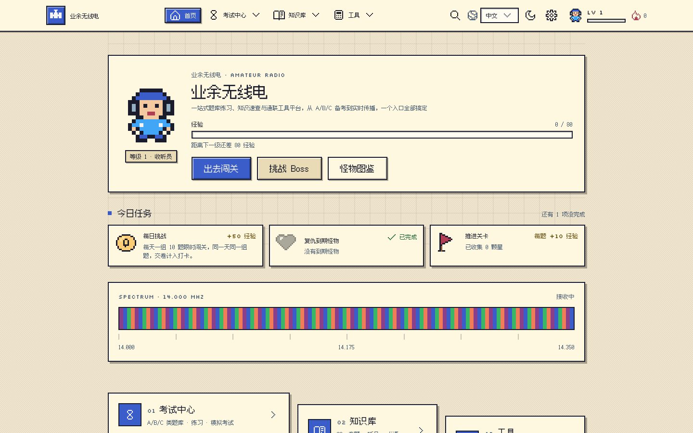
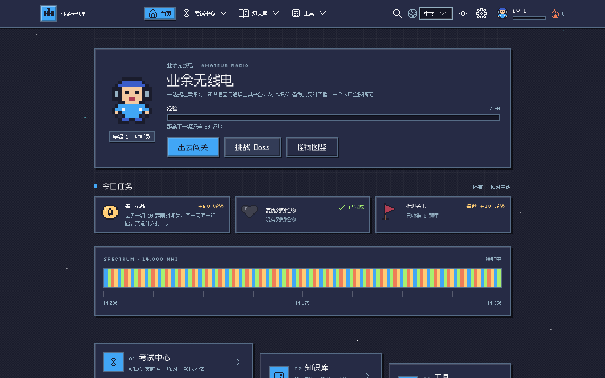
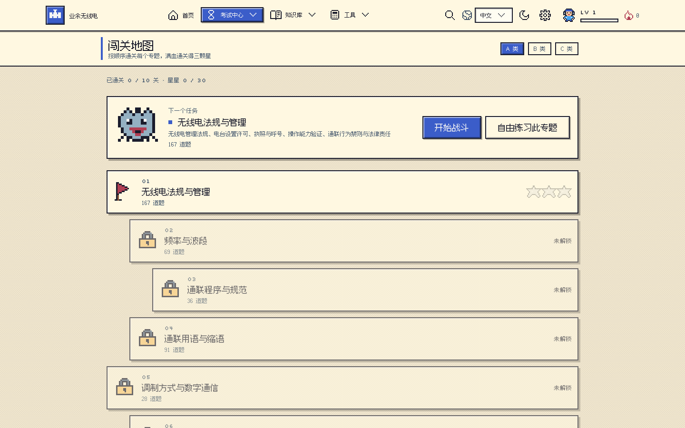
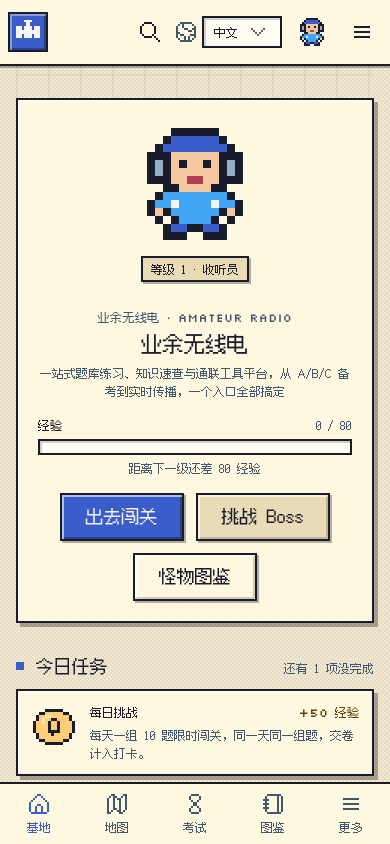

# 业余无线电｜题库 · 知识 · 工具

[](https://github.com/lf-wxp/ham-web/actions/workflows/check.yml)
[](LICENSE)
[](https://www.rust-lang.org)
[](https://leptos.dev)
[](#pwa-与离线)

**在线 demo：<https://ham.onlyxp.me/>** ｜ [快速开始](#快速开始) ｜ [功能一览](#功能一览) ｜ [文档地图](#文档地图) ｜ [贡献指南](#贡献指南)

一站式业余无线电学习平台：**A/B/C 三类题库**的练习与模拟考试、**100+ 专题知识库**速查，以及通联日志、实时数据与常用计算工具。

**全项目使用 Rust（2024 edition）编写**：前端为 Leptos（CSR → WebAssembly），服务器为 Axum（静态站点 + `/api/*` 数据代理），领域数据与算法在 `ham-web-core`，题库/解析/构建工具为 `ham-web-tools` 命令行程序。

目标读者：备考 A/B/C 类操作证的考生、希望系统入门的新手，以及需要日志、奖状与传播工具的进阶火腿。所有个人数据只保存在浏览器本地，不上传服务器；纯静态托管也能离线使用除实时数据外的全部功能。

<p align="center">
  <a href="docs/images/home-desktop.webp"></a>
  <a href="docs/images/home-dark.webp"></a>
  <br>
  <a href="docs/images/map-desktop.webp"></a>
  <a href="docs/images/home-mobile.webp"></a>
  <br>
  <sub>上：首页浅色 / 深色主题（桌面）；下：闯关地图（桌面）与首页（手机，等比缩放后与地图同高）。<br>取自本地 release 构建的真实页面，重拍见 <code>e2e/scripts/screenshots.mjs</code></sub>
</p>

---

## 快速开始

### 环境要求

- Rust ≥ 1.88（推荐最新 stable，见 `.tool-versions`）
- `wasm32-unknown-unknown` 目标、[Trunk](https://trunkrs.dev)、[cargo-make](https://github.com/sagiegurari/cargo-make)
- Node.js ≥ 22（**仅跑端到端测试需要**；构建与开发不需要 Node）

```bash
cargo install cargo-make
cargo make setup          # 安装 wasm32 目标、Trunk 与 wasm-bindgen CLI
```

> Tailwind CSS、wasm-opt 由 Trunk 首次构建时自动下载到本机缓存；解码 Worker 需要 PATH 上的
> `wasm-bindgen` CLI，版本由 `cargo make setup` 按 `Cargo.lock` 固定。

| 想做什么 | 命令 |
| --- | --- |
| 只调前端 | `cargo make dev` → http://127.0.0.1:3000 |
| 需要实时数据页（依赖 `/api/*`） | `cargo make dev-full` → 后端 3001 + 前端 3000 代理 |
| 生产构建 / 本地跑 release | `cargo make build` / `cargo make serve` → http://127.0.0.1:8080 |

完整任务清单见 [`docs/tasks.md`](docs/tasks.md)；本地开发细节、生产构建与部署见
[`docs/deployment.md`](docs/deployment.md)。

### 浏览器支持

| 能力 | 要求 | 不满足时 |
| --- | --- | --- |
| 题库 / 知识库 / 日志 / 计算器 | 任何现代浏览器 | — |
| 浏览器内解码（Web Worker + wasm） | WebAssembly | 页面提示不支持 |
| 三维方向图 | WebGL2 | 自动回退 SVG |
| 电台 CAT / KISS TNC / NanoVNA / 旋转器 | 桌面版 Chrome / Edge（Web Serial；Firefox / Safari 没有 `navigator.serial`） | 按钮置灰并提示「浏览器不支持」 |
| 后台推送 | HTTPS（或 `localhost`）+ 通知权限 | 降级为「未配置推送服务」 |
| 离线使用 | Service Worker | 仍需联网 |

## 功能一览

按模块列能力与关键约束；每条功能的完整说明（路径、参数、边界与已知限制）见
[`docs/features.md`](docs/features.md)。

### 考试中心

像素风 RPG 闯关（地图 / 回合战 / 怪物图鉴，等级由学习存档实时推算）、练习与闪卡 / 听题 / 呼号抄收、A/B/C 仿真考试（40/60/90 题 · 40/60/90 分钟）与考后复盘、错题本与自适应复习、学习进度 / 周报 / 备考计划 / 成就墙、计算题变体与错题归因图谱。

### 知识库

7 个分组、100+ 专题速查页（含莫尔斯训练、CW 抄收竞赛、波段表、天线建模等富交互页）、法规原文库（《管理办法》58 条 +《条例》85 条，逐条可搜并链接引用它的题目）、学习路径图、多国考试对照、知识溯源与自托管 KaTeX 公式。

### 工具与实时数据

60 项计算器（`/tools`）、太阳活动与空间天气、DX 热点与 DXCC 稀有度、卫星过境与多普勒修正、PSK Reporter / RBN 接收报告、点对点 MUF 与可靠度矩阵、DXCC / 网格地图、中继台 → CHIRP CSV、数据备份与合并导入。

### 天线与射频设计

矩量法求解器（`/nec`，≤ 200 段：方向图 / 扫频 / 设计存档 / 按 DXCC 实体的方向增益）、Smith 圆图、波形实验室、频率功率合规、测量误差实验室。

### 通联日志与 QSL

ADIF 3.1 日志与多台站 / 操作员、日志体检、QSL 全生命周期与多源确认同步、竞赛录入（Cabrillo 3.0）、奖状进度、QSL 卡片设计与标签打印、SOTA / POTA 激活导出。

### 浏览器内解码与硬件互联

十二个 Worker（十一个解码器 + AX.25 软 TNC）在浏览器内完成解码，音频不上传；Web Serial 接电台 CAT、KISS TNC、NanoVNA 与旋转器（写电台默认关闭，写前过硬护栏）。解码器清单见 [`docs/features.md`](docs/features.md)。

### 设备与 DIY

机型库（Sherwood 实测 + 六轴雷达图 + 场景加权打分）、评测文章、DIY 项目卡。

### 用户体验

`/` 唤起全站搜索（支持 `dxcc:` / `band:` / `mode:` 前缀）、11 套配色与明暗主题正交、三语界面、无障碍、PWA 可离线、wasm 失败兜底；所有个人数据只存本地。

## 文档地图

README 只做索引与上手；细节按下面的表找。

| 想做什么 | 看哪份 |
| --- | --- |
| 动代码前的总入口、硬规则、验收命令 | [`AGENTS.md`](AGENTS.md) |
| 架构、crate 划分、完整目录树 | [`docs/architecture.md`](docs/architecture.md) |
| 功能清单 / 存储 key / 路由表 / 任务清单 | [`docs/features.md`](docs/features.md) · [`docs/storage.md`](docs/storage.md) · [`docs/routes.md`](docs/routes.md) · [`docs/tasks.md`](docs/tasks.md) |
| 本地开发细节、生产构建、Docker、环境变量、Web Push | [`docs/deployment.md`](docs/deployment.md) |
| 题库数据：数据集构建、新增题库版本 | [`docs/data-pipeline.md`](docs/data-pipeline.md) |
| 题目解析：维护流程 / 写作规范 | [`docs/explanations.md`](docs/explanations.md) · [`docs/explanations-style.md`](docs/explanations-style.md) |
| 后端接口：同源代理与开放 API | [`docs/api.md`](docs/api.md) |
| PWA 缓存策略与图标 | [`docs/pwa.md`](docs/pwa.md) |
| 界面 / 表单控件 / 按钮 / 弹层 / 页头宽度 | [`docs/ui-components.md`](docs/ui-components.md) → [`crates/app/src/ui/README.md`](crates/app/src/ui/README.md) |
| 界面文案、译文、复数与三语门禁 | [`docs/i18n.md`](docs/i18n.md) |
| 代码规范、快捷键、像素风与动效降级 | [`docs/development.md`](docs/development.md) |
| 端到端测试、覆盖率与本地排障 | [`docs/testing.md`](docs/testing.md) |
| 解码器页面 / 新增解码器 / worker 协议 | [`docs/decode-worker-protocol.md`](docs/decode-worker-protocol.md) |
| 题库题面排版（空格、全角半角、指纹） | [`docs/typography.md`](docs/typography.md) |
| 外部数据（DXCC / 实体边界 / 题库）来源与新鲜度 | [`docs/data-sync.md`](docs/data-sync.md) |
| 串口功能与外部格式（CHIRP / SOTA / POTA）验收 | [`docs/hardware-verification.md`](docs/hardware-verification.md) |
| 天线方向增益的口径 | [`docs/antenna-coverage.md`](docs/antenna-coverage.md) |
| 代码质量、分层边界、问题分级 | [`docs/code-quality.md`](docs/code-quality.md) |
| 许可与 GPL 边界 | [`docs/licensing.md`](docs/licensing.md) |
| 未完成项与「刻意不做」的边界 / README 审核记录 | [`ROADMAP.md`](ROADMAP.md) · [`docs/readme-review.md`](docs/readme-review.md) |

> README 里的数字与清单（Worker 数量、路由数量、计算器数量、`build-*-worker` 任务表、截图文件）由
> `cargo make readme-check` 对账；被搬走的章节改名或删除时它也会红。

## 技术栈

| 层 | 技术 |
| --- | --- |
| 语言 | Rust 2024 edition（MSRV 1.88） |
| 前端 | [Leptos 0.8](https://leptos.dev)（CSR）+ `leptos_router`，编译为 WebAssembly |
| 前端构建 | [Trunk](https://trunkrs.dev)（自动下载 Tailwind CSS v4 独立版、wasm-bindgen、wasm-opt） |
| 样式 | Tailwind CSS v4 + tw-animate-css，沿用原 shadcn/ui（new-york）设计令牌与类名 |
| 图标 | Lucide（内联 SVG，与原版路径一致） |
| 浏览器 API | Web Speech API（朗读）、Web Audio API（摩尔斯 / 信号音 / 实时频谱）、Canvas（照片处理、瀑布图）、WebGL2（天线求解器的三维方向图，不支持时回退 SVG）、Notification（倒计时提醒）、IndexedDB（大体积日志存储） |
| 服务器 | Axum 0.8 + tower-http（SPA 回退、缓存头、gzip/brotli），并提供 `/api/*` 外部数据代理（`ureq` + 内存缓存 + `sgp4` 过境计算） |
| 数字信号解码 | `ham-web-apt` / `ham-web-sstv` / `ham-web-wspr` / `ham-web-ft8` 等十一个解码 crate（纯 Rust DSP，编译为 Worker，音频不上传服务器；另有一个 AX.25 软 TNC Worker，解码核心在 `ham-web-core`） |
| 工具链 | `ham-web-tools`（clap、ureq、resvg、sha2、brotli、walkdir） |
| 任务编排 | [cargo-make](https://github.com/sagiegurari/cargo-make) |
| PWA | 构建时由 Rust 生成 Service Worker（预缓存 + 运行时缓存策略） |
| 许可 | MIT（见仓库根目录 [`LICENSE`](LICENSE)）；DominoEX / LRPT / NAVTEX 解码器及其 Worker 例外，为 GPL-3.0（见[许可](#许可)） |

## 项目结构

```text
crates/core                  领域模型与纯计算（题库、考试、ADIF、呼号、传播、存储结构、注册表…）
crates/nec                   天线矩量法求解器（纯 std 零依赖）
crates/dsp · crates/wav      解码器共用的 DSP 原语与 WAV 解析
crates/app                   Leptos 前端（pages / components / ui / i18n / store）
crates/{apt,sstv,wspr,ft8,rtty,olivia,dominoex,navtex,lrpt,hell,wefax}   十一个解码核心
crates/*-worker              十二个 Web Worker 胶水（含 afsk1200 软 TNC）
crates/server                Axum 静态站点 + /api 代理 + /api/v1 开放接口
crates/tools                 构建与维护 CLI（数据集、解析、i18n、图标、各项守卫）
data/ · public/ · e2e/       数据与译文、构建产物与静态资源、Playwright 测试
docs/                        专题规范（本 README 的细节都在这里）
```

逐目录说明与分层边界见 [`docs/architecture.md`](docs/architecture.md)（`docs/code-quality.md` 里有
「core 不许碰浏览器 API」「crate 不许反向依赖 app / server」这类守卫说明）。

## 后端接口

`/api/*` 是**前端专用的同源代理**（Axum 代上游请求 + 内存缓存，规避 CORS），接口、上游数据源与缓存
时长逐条列在 [`docs/api.md`](docs/api.md)；第三方请用物理隔离、向后兼容的 `/api/v1/*`（OpenAPI 3.1：
`/api/v1/openapi.json`，文档页 `/developers`）。依赖 `/api/*` 的页面清单与纯静态托管时的降级行为
也在该文档里。

## 常用任务

| 任务 | 说明 |
| --- | --- |
| `cargo make setup` | 安装 wasm32 目标、Trunk 与 wasm-bindgen CLI（版本按 `Cargo.lock` 固定） |
| `cargo make dev` / `dev-full` | 前端 3000 / 再加后端 3001 与 `/api` 代理 |
| `cargo make build` / `serve` | 生产构建（图标 + 前端 + 服务器）/ 托管 `dist/` 于 8080 |
| `cargo make check` | 提交前门禁：格式 + clippy + 单测 + 文案/译文/解析/守卫/数据戳（不构建前端） |
| `cargo make ci` | `check` + release 前端构建 + 体积预算（提交前用这个） |
| `cargo make e2e` | 构建 release 站点并跑 Playwright |
| `cargo make dataset` | 从 CSV 重建题库 JSON 与图片 |
| `cargo make i18n-pack` | 生成运行时语言包（改了译文后跑） |
| `cargo make readme-check` | README 数字与清单、`docs/` 链接、截图文件的对账 |
| `cargo make clean` | 清理 `cargo clean` + `dist` / `tmp` |

完整任务表（解码器样本、像素风资源、数据同步、解析维护等）见 [`docs/tasks.md`](docs/tasks.md)。

## 部署

```bash
docker build -t ham-web .
docker run -d --name ham-web -p 3000:3000 -v ham-web-data:/app/data ham-web
```

构建参数（`SITE_URL` / `REBUILD_DATASET` / 工具链版本）、运行时与上游调优环境变量、实测构建耗时与
内存要求（前端编译峰值 6–8GB，Docker 虚拟机给 4–8GiB 会被 OOM 杀掉）、Web Push 的 VAPID 与订阅鉴权
都在 [`docs/deployment.md`](docs/deployment.md)。

## 数据与题库

- 题库 JSON 与图片已提交在 `public/questions/`，日常开发不必重建；需要更新时跑 `cargo make dataset`。
  数据源、CSV 列与产物清单见 [`docs/data-pipeline.md`](docs/data-pipeline.md)。
- 官方换版时按同文档的「新增题库版本」改 `public/questions/config.json`。
- 解析以**内容指纹**为 key 存在 `data/explanations.json`：统计缺失 → 撰写 → 合并 / 增强 / 写入的
  流程见 [`docs/explanations.md`](docs/explanations.md)，写作规范见
  [`docs/explanations-style.md`](docs/explanations-style.md)，术语表字段也在该流程文档里。

## PWA 与离线

`postbuild` 扫描 `dist/` 生成 `sw.js`（题库 NetworkFirst、题目图片 StaleWhileRevalidate、其余预缓存），
部署后页面可见时每小时检查更新并提示；应用图标由 `cargo make icons` 从三份设计源渲染。缓存策略、
更新流程与图标细节见 [`docs/pwa.md`](docs/pwa.md)。

## 本地存储与兼容性

题库相关的 key 与数据结构与旧版（Next.js）完全一致，升级后用户已有进度与偏好可继续使用；
全部 key 的清单见 [`docs/storage.md`](docs/storage.md)。

数据备份走站内 `/backup` 页（顶栏「设置」对话框、移动菜单与页脚均可进入）：导出全部本地数据为
`ham-backup-YYYYMMDD.json`，可在其他设备或清缓存后一键导入恢复，也可按模块勾选、跨设备合并导入。

> 通联日志（`logbook`）可能超过 localStorage 5MB 配额：日志改由 `IndexedDB` 权威存储 + `localStorage` 静默快照双写（见 `crates/app/src/kv.rs` / `idb.rs`），跨标签页可见性由 `storage` 事件保证。数据备份仍以 localStorage 快照为准；日志极大（快照被静默丢弃）时建议同时用「通联日志 → 导出 ADIF」留底。

## 开发与测试

- 提交前跑 `cargo make check`（不构建前端），正式提交用 `cargo make ci`；两者都含 `readme-check`。
- 动界面后跑 `cargo make e2e`；新增交互要补用例并把旅程写进 `e2e/coverage-targets.json`，口径与
  常见红见 [`docs/testing.md`](docs/testing.md)。
- 界面控件与页宽只有一套来源（`crates/app/src/ui/`），规则见 [`docs/ui-components.md`](docs/ui-components.md)。
- 文案走 `t("域.词条")`，新增词条 zh / en / es 三份齐全后跑 `cargo make i18n-pack`，规则见
  [`docs/i18n.md`](docs/i18n.md)。
- 代码规范、快捷键、改 UI 的注意点、像素风与动效降级见 [`docs/development.md`](docs/development.md)。

## 路由

页面按三大模块组织（共 180 个路径）；路由表在 `crates/app/src/app/main_content.rs`，路径 / 标题 /
图标 / 分组的唯一来源是 `crates/core/src/registry.rs`。完整路径表与带参数页面（`/practice?bank=A&multi=1`、
`/battle?stage=…`、`/cards?deck=…` 等）见 [`docs/routes.md`](docs/routes.md)。

## 常见问题

- **题库为空或 404？** 确认 `public/questions/` 下存在 `A/B/C.json` 与 `config.json`，必要时执行 `cargo make dataset`。
- **实时数据页显示“暂不可用”？** 这些页面依赖服务器 `/api/*` 代理（`cargo make dev-full` 或 `cargo make serve`）；纯静态托管时上游请求无处转发，属于预期降级。
- **首次构建很慢？** Trunk 会下载 Tailwind、wasm-bindgen、wasm-opt 并编译依赖，之后为增量构建。
- **wasm-opt 报 `bulk memory` 相关错误？** 已在 `index.html` 中通过 `data-wasm-opt-params` 启用新特性，请使用 `Trunk.toml` 中固定的 wasm-opt 版本。
- **更新部署后页面没有变化？** Service Worker 需要一次刷新才能激活，页面右下角会出现「发现新版本」提示（每小时自动检查一次）；也可在浏览器 DevTools → Application → Service Workers 中手动更新。
- **练习模式的搜索按钮不见了？** 题目搜索仅在练习模式的顺序模式下可用；跨全站的知识检索请用 `/` 唤起的搜索面板。
- **朗读 / 摩尔斯试听没有声音？** 浏览器需要一次用户交互后才允许播放音频，请先点击页面；朗读依赖系统 TTS 语音包。
- **`cargo make dev-full` 和 `cargo make i18n-check` 能同时跑吗？** 不能：两者都要占用 `target/` 的构建锁，同时执行会互相等待，建议串行运行。
- **改了解码 Worker 却不生效？** 十二个 Worker 的 wasm 由 `cargo make build-worker` / `build-sstv-worker` / `build-wspr-worker` / `build-rtty-worker` / `build-olivia-worker` / `build-dominoex-worker` / `build-navtex-worker` / `build-lrpt-worker` / `build-ft8-worker` / `build-hell-worker` / `build-wefax-worker` / `build-afsk1200-worker` 生成到 `public/*-worker/`（清单见 [`docs/tasks.md`](docs/tasks.md)，`cargo make readme-check` 会对账）；`cargo make dev` 与 `build-web` 会自动先构建，但单独改了 worker 代码后需重跑对应任务（首次还需 `cargo make setup` 提供版本匹配的 `wasm-bindgen`）。
- **端到端测试跑不起来？** 首次需在 `e2e/` 下执行 `npm ci && npx playwright install chromium`；`cargo make e2e` 会先构建 release 站点。
- **通联日志很大还能用吗？** 可以：日志由 `IndexedDB` 承载（突破 localStorage 5MB 配额），localStorage 仅保留静默快照。清浏览器数据会同时清除两者，重要日志请定期用「数据备份」导出。

## 贡献指南

欢迎提交 Bug 报告、功能建议、题库解析与术语补充、文档改进与代码 PR。

### 开发流程

1. Fork 并切出分支（如 `feat/…`、`fix/…`、`docs/…`）；
2. 本地执行 `cargo make setup`；改完后跑 `cargo make check`（或 `cargo make ci`，一并构建前端）与 `cargo make e2e`；
3. 提交 PR 并简述改动动机与验证方式，CI 会自动运行 `cargo make check` 与 Playwright 端到端测试。

提交信息沿用仓库现状的约定式风格，例如 `feat(beacons): 新增信标页`、`docs(explanations): 补充 C 类解析 50 条`。

### 各类贡献的入口

| 想做的事 | 从哪开始 |
| --- | --- |
| 修订 / 补充题目解析 | `data/explanations.json`，流程见 [`docs/explanations.md`](docs/explanations.md) |
| 补充术语 | `data/glossary/*.json`，随后 `cargo make glossary-check` |
| 新增知识专题页 | `crates/core/src/<name>.rs`（数据）+ `crates/app/src/pages/<name>.rs`（页面）+ `crates/core/src/registry.rs` 注册一条 + `main_content.rs` 加路由（导航与站点地图自动派生） |
| 界面文案翻译 | `data/i18n/`（界面，按域拆分）与 `data/knowledge-i18n/`（知识库正文） |
| 改 README / 补文档 | 先看[文档地图](#文档地图)；改完跑 `cargo make readme-check`（数字、任务清单、`docs/` 链接与章节引用都会对账） |
| 修 Bug / 加功能 | 不依赖浏览器的逻辑请在 `ham-web-core` 补单元测试；UI 改动注意 `crates/app/src/ui/` 的类名约定 |

> 新增页面时只改两处：**在 `crates/core/src/registry.rs` 的 `MODULES` 追加一条**（路径 / 标题 / 图标 / 分组），再在 `crates/app/src/app/main_content.rs` 加一行 `<Route>`（Leptos 需要具体组件类型，无法数据驱动）。导航菜单、`sitemap.xml` 都由注册表派生；`crates/app/src/registry_check.rs` 的测试会断言「注册表 ↔ 导航 ↔ 路由」三者一致，漏注册或写错路径会让 `cargo make check` 直接失败。页面同时自动纳入 `smoke.spec.ts` 的全站冒烟与无障碍检查。

### 报告问题

请附上复现步骤、浏览器与系统版本，以及控制台报错或截图；涉及题库数据的问题请注明类别与题号（题目左上角可复制 ID）。

## 许可

原创组件以 **MIT** 发布（全文见 [`LICENSE`](LICENSE)）；含 GPL-3.0 转写代码的六个 crate（DominoEX /
LRPT / NAVTEX 及其 Worker）单独按 `GPL-3.0-only` 发布，因此完整站点分发是 **MIT AND GPL-3.0-only**。
**MIT 不覆盖题库数据**：题目与解析版权归上游作者。

例外清单、第三方 MIT / BSD 声明（ft8_lib、KISS FFT）、发布物需随附的许可文件与部署方义务见
[`docs/licensing.md`](docs/licensing.md)。

## 致谢

- **题库数据**：[xiedada05/crac-amateur-radio-exam-questions-2025-csv](https://github.com/xiedada05/crac-amateur-radio-exam-questions-2025-csv)
- **相关项目**：[AlliotTech/ham-exam-web](https://github.com/AlliotTech/ham-exam-web)
- **开源项目**：Leptos、Axum、Trunk、Tailwind CSS、tw-animate-css、Lucide、Geist 字体、resvg、sgp4、[ft8_lib](https://github.com/kgoba/ft8_lib)（FT8 / FT4 内核转写来源，MIT）
- **数据来源**：HamQSL、NOAA SWPC、Celestrak、DXWatch、Club Log、wheretheiss.at、BigDataCloud、PE0SAT / CAMSAT（XW-2 转发器频率）、工业和信息化部（409 MHz 公众对讲机规定）
